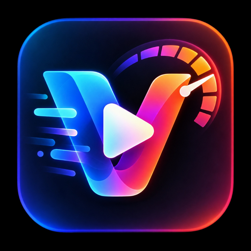
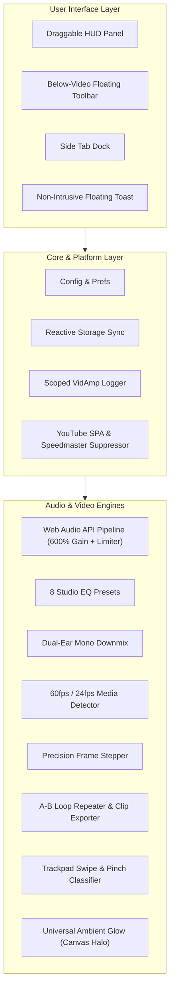

# ⚡ VidAmp: Universal Video Enhancer & Speed Controller

<div align="center">
  
  <h2>VidAmp — Universal Video Enhancer & Speed Controller</h2>
  <p><strong>The modern video powerhouse for Chrome, Edge, Brave, Firefox, Opera, and Arc.</strong></p>

  <p>
    <a href="https://github.com/Chandan-14r/VidAmp/actions/workflows/ci.yml"></a>
    <a href="#-automated-testing--code-quality"></a>
    <a href="#-typescript-architecture"></a>
    <a href="https://github.com/Chandan-14r/VidAmp/releases/latest"></a>
    <a href="LICENSE"></a>
  </p>

  <p>
    <em>Precision touchpad gestures, 600% super boost with brickwall limiter, universal ambient glow, studio EQ presets, 60fps frame stepper, smart media downloader, and instant WebM clip exporter.</em>
  </p>

  <p>
    <a href="https://github.com/Chandan-14r/VidAmp/releases/download/v6.2.0/VidAmp-v6.2.0-Chrome-Edge-Brave.zip"><strong>📥 Download Chrome/Edge/Brave Package (.zip)</strong></a> •
    <a href="https://github.com/Chandan-14r/VidAmp/releases/download/v6.2.0/VidAmp-v6.2.0-Firefox.zip"><strong>🦊 Download Firefox Package (.zip)</strong></a>
  </p>
</div>

---

## 🌟 Why VidAmp?

**VidAmp** transforms video playback into a modern, cinematic, and effortless experience across the web. Whether you are studying YouTube lectures at **1.4×**, watching films with dynamic **Ambient Glow**, boosting quiet dialogue with **Vocal Clarity**, frame-stepping through action scenes at true 60fps, or exporting video clips directly from A-B loops, VidAmp puts professional controls right at your fingertips without cluttering the screen.

---

## 🏗️ Architecture & Decoupled Modules

VidAmp is built on a clean, decoupled TypeScript architecture with high unit-test coverage:



---

## 🚀 Key Features

### 1. ⚡ Touchpad Gestures & Precision Speed Controller
* **Trackpad Pinch-to-Speed**: Two-finger pinch with deliberate threshold protection so normal vertical page scrolling is never accidentally hijacked.
* **1-Click Speed Popover**: Direct 1-click access to presets: `0.5×`, `0.75×`, `1×`, `1.25×`, `1.4×`, `1.5×`, `1.75×`, `2×`, `2.5×`, `3×`, `4×`.
* **Hold-to-2× with Rate-Guard**: Click & hold to temporarily boost to 2×; releasing immediately restores your exact previous rate.
* **Elimination of Sticky YouTube Overlays**: Completely strips YouTube's native lingering 2x pill using CSS suppression and MutationObserver DOM pruning.

### 2. 🔊 Audio Superpowers (Studio Web Audio EQ & 600% Super Boost)
* **600% Super Volume Boost**: Amplify whisper-quiet videos up to 600% using an internal Web Audio API gain node.
* **Brickwall Peak Limiter**: `-1.5 dBFS` brickwall compressor prevents digital clipping and speaker distortion at extreme volume levels.
* **8 Studio EQ Presets**: Normal (Flat), Vocal Clarity, Bass Boost Max, Treble Booster, Podcast Speech, Music Master, Night Mode, and Cinema Surround.
* **Dual-Ear Mono Downmix**: Downmixes single-ear or unbalanced stereo audio equally into both headphones.

### 3. 🌌 Universal Ambient Glow (Dynamic Bias Lighting)
* Real-time bias lighting aura rendered behind any HTML5 video player.
* Sampled at 32×18 and throttled at 20fps with GPU-accelerated CSS blur (`<0.2ms` GPU frame time) for zero dropped frames and zero CPU lag.
* Toggle with `Shift + A` or from the Below-Video Toolbar.

### 4. ⏱️ 60fps Frame-by-Frame Stepper
* Dynamic framerate detection calculates true framerate (24fps, 30fps, 60fps) from decoded playback quality metrics.
* On 60fps videos, steps precisely at ~0.01667s per frame without skipping.
* Shortcuts: `.` (step forward) and `,` (step backward).

### 5. 🎬 Mini-Clip / WebM Exporter (from A-B Loop)
* Mark Point A and Point B, then export the clip directly to a high-quality `.webm` video download.
* Uses native `MediaRecorder` + `captureStream()`.
* **100% Client-Side**: No external servers, no cloud uploads, completely private.

### 6. 📥 Smart Media Downloader (Generic HTML5 Sites)
* Automatic one-click download for direct `.mp4`, `.webm`, `.ogg`, and `.mov` media files on generic web pages (Vimeo, Reddit, social feeds, news sites, educational portals).
* **Policy Compliant**: Explicitly gates YouTube downloads with a friendly notice to ensure 100% compliance with Chrome Web Store policies.

### 7. 📌 Video Timestamp Bookmarks
* Save key moments with `Shift + B` or the toolbar ribbon.
* Stored persistently per video in `browser.storage.local`.
* Interactive popover lets you jump to timestamps or delete bookmarks with one click.

### 8. 🌙 Sleep Timer (Auto-Pause with Volume Fade & Countdown Badge)
* Fall asleep watching videos without running them all night.
* Cycles: **15m → 30m → 45m → 60m → End of Video → Off**.
* Live countdown indicator displayed directly on the HUD button and toolbar tooltip.

---

## 🎛️ Below-Video Enhancer Toolbar

A sleek translucent obsidian floating bar anchored right below videos covering ≥25% of the screen:

| Icon | Tool | Description | Shortcut |
|:---:|:---|:---|:---|
| 🔁 | **Loop Video** | Toggle continuous single-video loop | `Shift + L` |
| 🔊 | **Volume Booster** | Left-Click: 600% Loud Boost, Right-Click: Mute | `B` |
| 🎚️ | **Studio Presets & Mono** | Left-Click: Cycle Presets, Right-Click: Mono Audio | `V` / `Shift + M` |
| 🎬 | **Cinema Mode** | Dim page background to spotlight the video | `Shift + C` |
| 🌌 | **Ambient Glow** | Universal dynamic bias lighting halo | `Shift + A` |
| 📺 | **Web Theater Mode** | Fill browser window with player | `T` |
| 🪟 | **Picture-in-Picture** | Detach player to floating window | `P` |
| 📐 | **Aspect Ratio** | 21:9 ultrawide crop, stretch-to-fill, 16:9 fit | — |
| 🖥️ | **Fullscreen** | Enter native fullscreen mode | `F` |
| ⏱️ | **Speed Pill** | Live speed display + 1-click popover (0.5×–4.0×) | `[` / `]` |
| ✨ | **Video Filters** | Reset or cycle visual filters (HDR / Contrast) | — |
| 📸 | **Screenshot** | Instant full-resolution PNG/JPEG frame capture | `Shift + S` |
| ⚗️ | **A-B Loop** | Set Point A, Point B, and repeat segment | `Shift + [` / `Shift + ]` |
| 🎬 | **Export Clip** | Save loop segment as a `.webm` video | — |
| 📥 | **Download Video** | Direct media downloader on HTML5 video sites | — |
| 📌 | **Bookmarks** | Left-Click: Save timestamp, Right-Click: List | `Shift + B` |
| 🌙 | **Sleep Timer** | Auto-pause countdown with volume fade | — |
| ⚙️ | **Video Tools** | Open full floating controller HUD | `Alt + T` |

---

## 🧪 Automated Testing & Code Quality

VidAmp maintains strict quality assurance with automated test suites:

```bash
# Run Vitest unit tests (43 unit tests)
npm test

# Run strict TypeScript typechecking
npm run typecheck

# Package distribution zips for Chrome & Firefox
npm run package
```

```
✓ tests/trackpad.test.ts (8 tests)
✓ tests/eq-presets.test.ts (6 tests)
✓ tests/speed-grid.test.ts (5 tests)
✓ tests/volume.test.ts (7 tests)
✓ tests/gain-limiter.test.ts (4 tests)
✓ tests/fps-detector.test.ts (5 tests)
✓ tests/time-formatter.test.ts (5 tests)
✓ tests/loop-repeater.test.ts (3 tests)

Test Files  8 passed (8)
     Tests  43 passed (43)
```

---

## 🌐 Installation & Distribution

### Option A: Direct Extension Install from Release
1. Download `VidAmp-v6.2.0-Chrome-Edge-Brave.zip` (for Chromium browsers) or `VidAmp-v6.2.0-Firefox.zip` from the [Latest Release](https://github.com/Chandan-14r/VidAmp/releases/latest).
2. Unzip into a folder.
3. Open `chrome://extensions` (or `edge://extensions`, `brave://extensions`).
4. Enable **Developer Mode** in the top right.
5. Click **Load Unpacked** and select the unzipped directory.

### Option B: Local Development from Source
```bash
git clone https://github.com/Chandan-14r/VidAmp.git
cd VidAmp
npm install
npm test
npm run package
```

---

## 📄 License

Distributed under the [MIT License](LICENSE).
